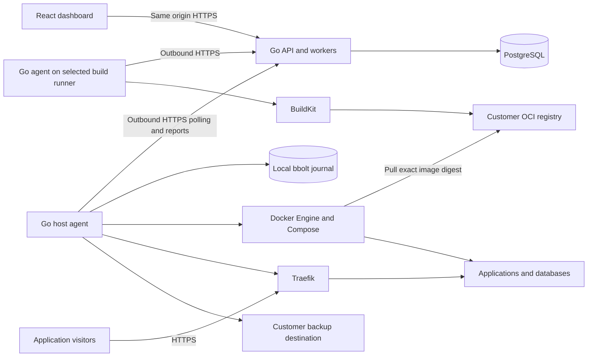

# Astilba platform architecture

Status: consolidated architecture, 22 October 2026. Product decisions reflect the design interview. Implementation choices and operating limits must pass the experiments and acceptance criteria in the [implementation plan](platform-implementation-plan.md).

Astilba provides a visual deployment workspace for applications running on the customer's servers. The same complete application runs as a hosted management service or a self-hosted installation. The management service owns configuration and operation history; an agent on each server executes approved operations and keeps workloads running independently of dashboard availability.

An **agent** is the Astilba program installed on a deployment server or build runner. It is not a user account or an AI coding agent; one user can manage many connected agents.

The [product brief](platform-product-brief.md) defines the product promise. This architecture defines how to deliver it without turning the product into a collection of independent infrastructure services.

## Initial product boundary

A project contains logical environments such as production and staging. An environment owns its configuration and deployment history; a deployment unit owns placement on a server. The first release permits one deployment unit per environment, running on one Linux Docker host. Model these separately so adding deployment units later does not redefine environment identity. A server belongs to one workspace and can host several environments from that workspace.

The initial support target is Ubuntu 24.04 LTS with systemd and rootful Docker on a virtual or physical server. Validate amd64 and arm64 in P0 before including either in the published host matrix. Docker Desktop, Windows hosts, rootless Docker and appliance-specific installations are outside the first supported matrix.

Each environment uses either visual configuration or a Compose project as its authoritative source. Initial visual resources are web applications, workers, scheduled container jobs, PostgreSQL, persistent volumes and HTTP or TCP routes. Applications originate from container images or repositories on GitHub, GitLab and Gitea. Backups and verified restoration are required for the paid beta. Tested major upgrade recipes follow as a separate milestone.

This is a platform for solo developers and small trusted teams running their own workloads. Docker networks provide useful application separation, but sharing a Docker daemon is not a security boundary for mutually untrusted tenants. Docker access gives the agent substantial authority over its host. Customers supply deployment servers and may supply separate build runners; builds never run inside the management service. Reseller hosting and mutually untrusted application tenants are outside the first release. [Docker security](https://docs.docker.com/engine/security/).

Future boundaries for multiple deployment units, Kubernetes, live collaboration, database administration and interactive terminals are defined below. Their implementation, UDP routing, built-in ingress tunnels, existing-workload adoption and Astilba-operated build runners or registries are deferred. No interview or external customer commitment is required before building; validate first on disposable infrastructure and then the maintainer's own non-critical workloads.

## Technology decisions

| Area | Choice | Purpose |
| --- | --- | --- |
| Dashboard | TypeScript, React and Vite | Publish static browser assets; bundle them with Go for the simplest self-hosted installation. |
| Navigation and remote state | TanStack Router and TanStack Query | Keep URLs typed and API loading, invalidation and mutations consistent. |
| Graph editor | React Flow | Render custom service cards and meaningful connections. |
| Design | Platform-specific components and Panda CSS | Establish accessible controls and consistent design tokens in this repository. |
| Compose editor | CodeMirror 6 | Edit files with validation feedback and source locations. |
| Management application | Go, `net/http` and chi | Run the API, agent endpoints and durable workers in one application. |
| Database | PostgreSQL 18, pgx and sqlc | Store transactional product state and generate typed access from SQL. |
| Migrations | Goose SQL migrations | Apply explicit, ordered database changes. |
| Background jobs | River open-source core, subject to the first validation milestone | Dispatch durable work using the existing PostgreSQL database. |
| API contracts | OpenAPI, oapi-codegen, openapi-typescript and openapi-fetch | Generate Go interfaces and TypeScript bindings from one contract. |
| Host agent | Go, with a bbolt journal | Persist operation progress locally without another database service. |
| Containers | Docker Engine SDK, the maintained Compose Go plugin and compose-go | Inspect containers and execute standard Compose projects. |
| Builds | Dockerfile and validated Railpack providers through BuildKit | Build on an explicitly selected deployment server or customer-owned runner. |
| Application ingress | Traefik on each deployment host | Serve HTTP, HTTPS and explicitly published TCP routes. |
| Backups | restic plus native database dump and restore tools | Store encrypted backups with explicit consistency guarantees. |

Use Node 24.18.1 and pnpm 11.17.0 for JavaScript tooling. Select and record exact Go, PostgreSQL patch, library, tool and image versions during milestone P0. Commit lockfiles, `go.sum` and image digests. Record JavaScript dependency pins when the dashboard is introduced. Do not install development tools from floating tags.

React Flow is a renderer and interaction library; it does not define Astilba's deployment format. Automatic layout is optional. Start with manual placement; evaluate Dagre for an arrange action and ELK only if grouping requires it. [React Flow layout options](https://reactflow.dev/learn/layouting/layouting).

The [PLAT-1 editor experiment](../experiments/canvas-editor/README.md) retains React Flow 12.12.0, React 19.3.1 and Panda 2.3.0 after exercising custom service cards, typed connections, keyboard/list editing and independent layout/configuration saves in Chromium and WebKit. Its 250-node synthetic probe avoids graph-wide custom-node and property rerenders during dragging. These are pinned experiment versions and measured feasibility, not a production capacity or complete accessibility claim. The fixture's browser storage and small controls remain separate from the production application.

The [P1 application](../services/platform/README.md) uses React 19.3.1, Vite 8.3.5, Panda 2.3.0, TanStack Router 1.170.45 and Query 5.104.5. Its Go 1.27.3 module pins SCS 2.9.0 with the pgx session store, Argon2id 1.0.0 and OTP 1.5.0. OpenAPI and sqlc output are generated and checked deterministically. The initial versioned specification stores application source descriptors and variables; the richer visual resource catalogue and deployment planner remain P3. Production code does not import the validation experiments.

## Runtime topology



The Go management application contains HTTP handlers, domain modules and workers. They share a Go module and database. Workers may later run as a separate process from the same codebase if measured load warrants it; that does not change the domain model or agent protocol.

The self-hosted management installation consists of the application and PostgreSQL, with HTTPS termination supplied through a documented proxy configuration. Its production application image requires no Node runtime. Management HTTPS can use the operator's existing proxy and is separate from the choice of Traefik for application ingress. The management server itself becomes a deployment or build target only when the operator explicitly enrolls an agent there.

Deployment hosts run the agent, Docker and Traefik. Build-only hosts run the agent and build tools without production ingress. The agent initiates management connections, so it needs no publicly reachable administration port or stored SSH credentials in the dashboard. Public applications still require customer-provided reachable ingress and suitable DNS; outbound agent connectivity does not create an application tunnel. Customers configure the necessary registry, Git and backup connectivity.

## Management deployment targets

The management service does not require a dedicated VPS or have to share a machine with customer applications. It needs reachable compute for the API and workers, PostgreSQL, and HTTPS. The UI is static and can be served separately. Running the management service on an existing server is supported by the same packaging; running it on a laptop is useful for development but remote agents still need a reachable endpoint while it is available.

| Deployment | Dashboard | API and workers | Persistent data |
| --- | --- | --- | --- |
| Portable self-hosted default | Served by the Go application | Go application on an existing server or container host | Local or external PostgreSQL |
| Cloudflare frontend | Workers Static Assets | The same Go application on another host | PostgreSQL reachable by the Go application |
| Optional Cloudflare management hosting | Workers Static Assets | Go application in Cloudflare Containers, behind a thin Worker integration | External PostgreSQL; no reliance on container-local durable storage |

Cloudflare's own Containers starter runs a Go HTTP server, so optional Cloudflare hosting does not inherently require replacing Go. Treat it as a deployment adapter: the same management application, agents and protocol remain usable without Cloudflare. Native Workers execution is a separate architecture choice; compiling isolated Go code to Wasm does not make the proposed Go server and River worker loop a drop-in Workers application. [Cloudflare Go container starter](https://developers.cloudflare.com/containers/get-started/), [Workers Static Assets](https://developers.cloudflare.com/workers/static-assets/).

The [PLAT-6 experiment](../experiments/cloudflare-hosting/README.md) validates complete management hosting on Cloudflare Containers at 0–20 synthetic agents, including sleep, replacement, database connectivity, SSE, long polling and scheduled wake. This makes the adapter feasible; it is not a production capacity or cost-saving promise. Container-local disk is ephemeral by default. Keep authoritative state in PostgreSQL and inject wrapping keys through the deployment's secret mechanism. Hyperdrive connects Workers to an existing database; it does not supply a hosted PostgreSQL database for this architecture. [Container lifecycle](https://developers.cloudflare.com/containers/platform-details/), [Hyperdrive](https://developers.cloudflare.com/hyperdrive/).

Use one public origin for the browser's assets and API even when their hosting is split; a narrowly configured Worker proxy can provide this on Cloudflare. Preserve the same authentication, CSRF, cache-control and credential rules. Do not expose provider bindings to domain code or require Cloudflare credentials in an ordinary self-hosted installation.

Cloudflare for SaaS is an optional custom-domain and edge-routing integration. It can front an origin hosted outside Cloudflare, so it does not determine the API runtime. Custom management domains and routing traffic for customers' deployed applications are distinct features. Application traffic initially reaches each customer's Traefik directly; operating an Astilba edge proxy or tunnel is later scope with separate availability and cost implications. [Cloudflare for SaaS](https://developers.cloudflare.com/cloudflare-for-platforms/cloudflare-for-saas/).

Measure costs before choosing the hosted deployment or promising lower customer prices. Frequent agent polls and heartbeats can keep a container active continuously. Cloudflare Containers charges provisioned memory and disk while active, active CPU usage, and associated Workers and Durable Objects usage; PostgreSQL is an additional cost. Compare that complete workload with a small conventional host, including retained logs and database traffic. [Container pricing](https://developers.cloudflare.com/containers/pricing/).

## Domain model and ownership

| Entity | Responsibility |
| --- | --- |
| Workspace and membership | Own users, servers, projects, credentials and backup destinations. Initial roles are owner, operator and viewer. |
| Server and agent identity | Bind an enrolled agent to one workspace and machine identity, with deployment, build or both roles. Record capabilities and observed health. |
| Project | Group related environments and their product-level metadata. |
| Environment | Group configuration, secrets, source ownership and history independently of physical placement. Own draft and applied revision pointers. |
| Deployment unit | Bind a group of resources to a runtime and target server. Initially one per environment; each Compose project always stays one unit unless explicitly converted. |
| Git connection and source | Identify a provider, configured base URL, repository, immutable commit and configuration ownership. Keep credentials outside source bundles. |
| Build run and artifact | Record runner selection, source commit, declared inputs, target architecture and immutable image identity independently of deployment. |
| Specification revision | Preserve an immutable visual specification or Compose source bundle, its schema version and content hash. |
| Deployment plan | Freeze proposed effects, expected applied revision, resolved artifacts and required capabilities for review. |
| Operation and step | Track execution, checkpoints, cancellation, errors and uncertain outcomes. |
| Secret and secret version | Store encrypted values separately from ordinary specifications and identify versions without exposing values. |
| Backup destination and policy | Define storage access, scope, schedule, retention and consistency method. |
| Backup record | Identify an actual snapshot, its manifest, source versions and verification result. |
| Upgrade recipe | Define supported source and target versions, preconditions, ordered steps and recovery boundaries. |
| Audit event | Record actor, workspace, action, affected resource and outcome without secret values. |

PostgreSQL is authoritative for desired configuration, approvals, identity and management history. Immutable revisions can use versioned JSON documents; ownership, identity, lifecycle and relationships use relational tables. Introduce tables for real query and integrity requirements rather than mirroring every canvas property into a separate table.

The agent journal is authoritative for which local steps it accepted and what it observed during execution. Docker and Traefik provide actual runtime state. The control plane reconciles these observations; a successful HTTP response alone does not prove an operation completed.

Detect differences between observed resources and the approved configuration. Show drift caused by direct Docker changes and offer an explicit reconciliation plan. Observation alone must not overwrite an operator's changes or delete unmanaged resources. Docker's normal container restart policies still operate independently of management connectivity.

All tenant-owned rows carry a workspace identifier. Queries require the verified workspace context; composite foreign keys protect relational ownership links. References inside specifications also undergo server-side ownership and type validation. Agents obtain their workspace and server context from their stored identity, never from an untrusted request field.

## Configuration and the canvas

### Visual environments

Define a versioned `EnvironmentSpec` containing resource identities, application sources, variables and secret references, bindings, volumes, routes and health checks. Keep deployment-unit placement explicit and separate from logical environment identity. Resource IDs remain stable across revisions. Creating a separate environment creates new runtime identities and credentials.

A connection has an explicit type and meaning. An application connected to PostgreSQL can bind its `DATABASE_URL` to the database's exported connection value. A volume connection specifies a mount. A route specifies its protocol, target service, port and relevant domain or listener. The API checks these relationships and shows their concrete effects before deployment.

An ordinary service connection does not imply a firewall rule or execution order. Services on a deployment unit's Docker network can communicate without a drawn binding. Readiness dependencies are separate validated configuration, with cycles rejected where they would prevent startup.

[Named service outputs and the maintained catalog](service-catalog.md) define the current visual connection types, legacy PostgreSQL readiness behavior, secret/export rules and per-recipe maintenance support. Catalog selection stages an ordinary specification; it does not create a separate runtime or edit Git-owned files.

Canvas positions, selection and viewport state are separate from deployment configuration. Saving a layout must not create a deployment revision or restart a workload. Persist positions per environment and keep selection and viewport preferences local to each user. React Flow's internal state is not stored as the canonical application format.

Use optimistic updates and revision preconditions for draft editing. Concurrent changes return a conflict with a fresh revision to review; do not silently replace another user's edits. Live collaborative dragging can be added later without changing deployment semantics.

Cloning a visual environment creates independent configuration, identities and fresh storage. Copying selected secrets or restoring data requires explicit choices. Remap internal bindings to the cloned resources so staging does not silently point at production. Later configuration changes remain independent unless deliberately promoted. Git-managed environments use their repository workflow to create the corresponding source configuration.

### Source ownership and Git changes

Application code and deployment configuration have separate ownership. A dashboard-managed environment can build application code from Git without making Git authoritative for its infrastructure. A Git-managed Compose environment treats the selected repository files and merged revision as authoritative.

Support GitHub, GitLab and Gitea with equal core workflows: repository import, deployment triggers and configuration pull or merge requests. Include configured self-hosted GitLab and Gitea URLs. Use three tested provider adapters for authentication, webhook validation and repository operations; do not assume their APIs or webhook signatures are identical. Self-hosted operators supply their own provider credentials. Configured Git endpoints must be reachable by the relevant management integration and build runner.

For Git-managed configuration, accumulate supported canvas and file edits in a draft based on an exact commit. Show the resulting file diff and explicitly submit one branch and pull or merge request. Review and merge on the Git provider initially. Pending drafts do not alter deployed configuration; a merge creates a new source revision, subject to the environment's deployment policy. Detect a moved base or conflicting edits and require reconciliation rather than overwriting remote work.

The [PLAT-7 experiment](../experiments/git-compose/README.md) validates this request/merge/re-import path on hosted GitHub and pinned self-hosted GitLab/Gitea. It preserves raw source for direct image edits and rejects ambiguous ownership. Production still needs durable draft reconciliation, complete explicit bundle resolution and persisted webhook processing.

### Compose environments

The [Compose workflow](compose-deployments.md) implements file-authoritative image deployments. A Compose environment owns a source bundle: its Compose files and explicitly included supporting files, source revision and separately supplied variables and secret references. Original file contents remain authoritative. Resolve paths within that bundle and validate using compose-go with explicit inputs; the management process's ambient environment must never supply interpolation values.

The canvas shows a derived view of services, networks and storage. Support visual edits where they can be mapped back to precise source edits without losing unrelated fields, comments or extensions; show their file diff. CodeMirror remains available for file editing and constructs without a supported visual edit. Reject an ambiguous rewrite rather than flattening anchors, merging files destructively or silently dropping configuration. Resource inspection, logs, deployments and backup attachment remain available from the graph.

Validate capabilities such as host networking, privileged containers, host mounts and Docker socket access. Explain elevated permissions during review. Remote includes, external file paths and unsupported Compose features fail with a clear source location until their semantics and access policy are implemented. Preserve custom extensions. Never run a YAML load followed by a lossy rewrite.

A Compose project remains one deployment unit on one host even after multiple deployment units are implemented for visual environments. Splitting it requires an explicit conversion or migration with reviewed networking and storage changes.

### Exports

Export a versioned Astilba source document and a runnable Compose bundle for supported visual workloads. Compose environments export their original bundle. Include image identities or source commits, route configuration, volume mappings, restore instructions and a manifest of additional prerequisites. Ordinary exports contain secret placeholders; a separately requested encrypted secret export requires recent authentication.

Configuration export does not move volume data or make image builds bit-for-bit reproducible. Data moves through backup and restore. Backups and exported configuration must have a documented path to ordinary Docker operation without contacting an Astilba service.

## Planning and deployment

The deployment planner is ordinary Go application code with explicit input and output types. It validates a saved revision, resolves artifacts and produces an ordered list of effects. Build outputs, image identities, secret versions, deployment-unit placement, recipe versions and expected applied revision belong to the frozen plan. Do not introduce a general-purpose language or plugin framework for this model.

1. Save and validate the draft using its expected revision.
2. Resolve registry images to immutable identities, and build repository sources at an exact commit before the final deployment review. Build-only work is visible as its own operation and does not change running services.
3. Produce the plan and its hash. Show configuration differences, changed images, storage effects, downtime and backup requirements.
4. Apply the exact reviewed plan in a transaction that records the actor, checks its expected applied revision and enqueues its operation through River.
5. Dispatch it to the bound agent with a stable operation ID, plan hash and monotonically increasing environment generation.
6. The agent journals acceptance before effects, performs preflight checks, executes steps and reports observations and progress.
7. Mark the revision applied only after the expected runtime state and health checks are confirmed. Keep failed attempts and their diagnostics.

Track observed state per resource separately from the last fully applied revision. If execution partially succeeds, show the resulting mixed state and reconciliation required instead of claiming the entire previous revision is still running.

Changes to a reviewed input invalidate the plan. Replayed apply requests return the existing operation using an idempotency key. A server becoming temporarily offline does not authorise skipping review or changing its target.

Each environment initially permits one active mutation. Host-wide changes, including Traefik configuration, also require agent-side serialisation. Generation checks and the agent journal fence out duplicate or stale execution after a control-plane worker loses its lease. A replacement worker follows the existing operation before it can create a conflicting one.

Automatic deployment is opt-in per environment. A merged configuration change or successful build can trigger the same plan and policy checks as a manual deployment, but cannot authorise volume deletion or a stateful major upgrade. Those operations require separate review even when their source change has merged.

Promote a built artifact between environments by reusing its immutable image identity. Resolve runtime variables and secrets for the destination environment. A change to build-time inputs requires a new build and is not promotion of the same artifact. Repository configuration changes follow their own source review rather than bypassing Git ownership during promotion.

Store explicit operation states: `queued`, `dispatched`, `running`, `waiting_for_agent`, `needs_attention`, `succeeded`, `failed` and `cancelled`. Keep cancellation requested as a separate flag. A disconnected agent produces an unknown execution outcome, not an automatic failure followed by a fresh run. Cancellation takes effect only at a safe checkpoint or after a tool's outcome has been reconciled.

Operation lifetimes are independent of browser requests and polling connections. Closing a tab or losing a response does not cancel work. Persist operation-specific deadlines and cancellation requests, and include scheduled maintenance in the same resource coordination rules as interactive deployments.

River schedules and retries work; application state and the agent journal define whether a particular effect can run again. Persist intermediate operation checkpoints in application tables and use River's transactional job completion for the final acknowledgement. The PLAT-2 prototype found that River 0.49.0's transactional resumable helper can retain in-memory progress after a database transaction fails; do not use that progress as proof that an operation checkpoint committed. Keep explicit runtime reconciliation for external effects. Use no River Pro dependency. [PLAT-2 experiment](../experiments/durable-execution/README.md), [River resumable jobs](https://riverqueue.com/docs/resumable-jobs).

## Agent protocol and host execution

Use versioned HTTPS endpoints for enrollment, outbound command polling, acknowledgements, heartbeat reports and bounded log batches. Start with ordinary long polling rather than a persistent WebSocket protocol. Proposed initial defaults are a 25-second poll, a 15-second heartbeat and an offline indication after 45 seconds without contact; validate these under a real HTTPS proxy in P0.

The [PLAT-3 transport fixture](../experiments/durable-execution/TRANSPORT.md) validates those intervals through Traefik with verified TLS. Keep heartbeats independent of polling and local execution. Budget the proxy's upstream response-header timeout above the poll duration (30 seconds in the fixture), and the client and response-write timeouts above that (35 seconds). Retain commands until their authenticated terminal reports, so a lost poll response permits redelivery of the same identity.

Provide a versioned agent artifact and a reviewable installation command. Verify the artifact before execution, create a protected local state directory and install a systemd service. Inspect an existing Docker installation and ingress configuration before making host changes; show any required package installation or port changes explicitly. Enrollment and installation are separate steps so operators can inspect and run the binary themselves.

An authenticated operator creates a short-lived, single-use enrollment token bound to a server record and its deployment, build or combined role. The agent exchanges it over verified TLS for a cryptographically random server credential, stored as a hash in PostgreSQL and with restrictive permissions on the host. Credentials are server-scoped, revocable and rotatable. Build-only agents receive only their assigned build inputs, source credentials and registry permissions; they have no production runtime secrets or deployment authority. Role changes are explicit privileged operations. Define a bounded rotation overlap so an interrupted exchange cannot permanently strand an otherwise valid agent. Enrollment credentials never become ordinary login sessions.

This initial protocol uses scoped credentials over HTTPS. Mutual TLS is an optional later hardening decision, not an additional listener or certificate authority required to install the first release. Every request still checks the server's identity and current revocation status; possession of one agent credential grants no access to other servers or browser administration APIs.

The rotation experiment uses a two-minute overlap and persists the proposed credential on the agent before exchange. Recovery first checks whether that candidate is already current; retrying a completed exchange must not extend the previous credential's expiry. A previous credential can repeat that exchange but cannot initiate another rotation. If no persisted credential remains valid, require re-enrollment. These are protocol decisions to carry into production; the fixture's process-local poll limit and short fixed reconnect delay are not production scaling or backoff implementations.

Commands identify a typed operation and versioned payload. The agent checks the server identity, supported schema, generation and plan hash, then journals its acceptance. Duplicate deliveries return the existing operation state. Invoke tools with argument arrays and explicit environments, not shell-interpolated strings. Images, repositories and Compose files remain executable customer inputs and are handled within the documented host trust boundary.

Persist operation IDs, step intent, completion evidence, applied generations and enabled schedules in bbolt. Persist secret-bearing payloads encrypted with a host-local key; keep keys outside the journal with restrictive permissions. After a process or machine restart, inspect operation-labelled containers, images, networks and volumes before continuing. An ambiguous destructive step enters `needs_attention`. Never infer success only from a missing subprocess. [bbolt](https://github.com/etcd-io/bbolt).

Workloads and Traefik keep running while the agent or management service is down. An accepted operation may continue locally. Installed backup and cron schedules continue while the management service is unreachable, provided the agent and their required credentials are available. Connectivity loss is visible in the dashboard without turning healthy application containers into failed deployments.

Use ownership labels and dedicated state directories. Deletion and cleanup act only on owned resources. Ordinary service deletion retains persistent volumes; data deletion is a separate reviewed operation. An existing host is inspected for port conflicts, disk space, Docker capabilities and an existing ingress proxy before enrollment becomes ready. Existing containers, volumes and routes remain unmanaged. Coexist where the configuration permits it; do not replace another tool's ingress or silently adopt its applications. An explicit adoption or migration workflow is later scope.

The production P2 implementation follows these boundaries in `services/platform/internal/execution` and `internal/agent`. It admits one active mutation per host and environment, uses a 16 KiB agent request limit and a 128-outcome acknowledged journal window, and exposes only the fixed probe recipe plus signed agent updates. The [agent guide](agent.md) describes installation and recovery. Compose and ingress execution remain P3/P4 work.

## Application networking

[Server and domain onboarding](server-onboarding.md) provides an optional installation-owned application domain. Server wildcards resolve directly to owner-approved public addresses; Astilba does not carry application traffic. Generated names bind workspace/environment/application/server identities and remain ordinary reviewed routes. Manual DNS works with any provider; the optional Cloudflare adapter owns only its marked records. Generation-bound DNS work is fenced during management recovery until renewed owner approval, independently of agent transfer.

Create an isolated Docker network for each initial deployment unit, with stable service DNS names for bindings. PostgreSQL and TCP services are private by default. Publishing them requires review of the endpoint, access restrictions and TLS behaviour. Credentials remain separate for each environment. Public ingress requires customer-controlled reachability and DNS; automatic tunnels and UDP are outside the first release.

Traefik is the only bundled application proxy in the first release. Keep ordinary route intent in a proxy-neutral model and use a Traefik adapter to render HTTP and TCP configuration through its file provider. Reserve public listener ports at host scope and detect conflicting domains, ports and DNS configuration before applying a plan. Keep the proxy administration interface inaccessible from application networks and the public internet. [Traefik file provider](https://doc.traefik.io/traefik/reference/routing-configuration/other-providers/file/).

Offer common route settings through forms and project-scoped advanced Traefik configuration through an explicitly restricted schema. Do not copy arbitrary YAML into the file provider: reject templates and arbitrary host paths, namespace generated resources, validate backend ownership and rewrite permitted references. Reject references to other projects or arbitrary providers, including the internal API. Separate files do not create a security boundary within a provider namespace. Host-wide listener, provider and TLS-default settings are restricted to workspace owners. Include advanced configuration in plans and exports. [Traefik provider namespaces](https://doc.traefik.io/traefik/providers/overview/#provider-namespace).

Render from the agent's complete applied route registry under a host-level lock held through registry reads, claim validation, publication, runtime checks, promotion and any rollback. Validate schema, references and policy before publication; retain the previous configuration and verify resulting routes after reload. If runtime checks fail, restore the previous generated configuration and verify recovery. Traefik can disable individual invalid services or routers, so routing changes cannot be assumed to be transactional or recovery uninterrupted. Fault tests must cover publication, verification and recovery without losing unrelated projects' routes. [Traefik runtime configuration migration examples](https://doc.traefik.io/traefik/migrate/v3/#tcp-and-udp-weighted-services-negative-weights).

The [PLAT-4 host experiment](../experiments/durable-execution/HOST.md) records the pinned Ubuntu/Docker/Compose baseline, native architecture results and standalone export limits. Compose 5 is the maintained Go plugin successor to v2; it retains the `docker compose` workflow. [Compose history](https://docs.docker.com/compose/intro/history/).

Initial deployments declare a possible restart window. Health checks and explicit failure reporting are required; universal zero-downtime deployment is not an initial guarantee. Do not automatically run an old image against data that the new image may have migrated.

## Builds and artifacts

Select a specific server with the build role. A server may have both deployment and build roles, but a build-only identity cannot deploy applications. Clone source on the assigned runner at an exact commit using provider-appropriate, narrowly scoped credentials. Verify webhook signatures, deduplicate events and resolve the commit before creating work. Builds never execute inside the management service. Automatic pull-request previews use explicit visual templates and dedicated preview-only combined servers, with independent runtime identities/secrets, exact-commit fork approval and confirmed cleanup. See [Pull-request previews](pull-request-previews.md).

If the selected runner is offline or busy, queue the build and show its state. Never silently move it to a production server. An operator may explicitly configure a fallback. Record the actual runner, source commit, target architecture and input versions so retries and artifacts remain attributable.

GitHub App connections require a repository administrator to delegate access to a workspace bot. Temporary user authorization proves that delegation; subsequent automation uses repository/action-scoped installation tokens and local trusted bindings. Workspace archives do not import those bindings. Active binding checks gate credential delivery, with successful provider authority/identity validation reused for at most five seconds to bound runner polling load. See [GitHub App onboarding](git-builds.md#github-app-onboarding).

Dockerfiles through BuildKit are the baseline. The production Railpack path supports the validated Node/npm, Go and shell matrix for repositories without a Dockerfile. It pins planner/frontend and image inputs, journals the prepared plan before execution, isolates declared build secrets and retains explicit command overrides; see [Git and builds](git-builds.md#railpack-builds). Record builder version, build inputs and resulting image identity. Bound concurrency, CPU, memory, disk use and retained artifacts, especially when building alongside production services. A failed build must not consume the disk capacity reserved for running databases. [Railpack](https://github.com/railwayapp/railpack).

Remote builds publish to a customer-configured OCI registry such as GHCR, GitLab or a self-hosted registry. Capture the resulting digest and deploy that exact artifact; grant runners push and deployment agents pull access only where needed. Show registry setup and connectivity checks during onboarding. A same-host build can use its local immutable image identity without a registry. Transfer or promotion to another host requires publishing that artifact through a registry. An Astilba-operated registry and paid build fleet are separate future services.

The [PLAT-5 experiment](../experiments/durable-execution/BUILD_DATA.md) pins BuildKit/buildctl 0.34.1 and validates the remote build-to-registry-to-deployment path with separate image stores and scoped registry credentials. Its same-VM services validate the protocol and storage boundaries, not hostile multi-tenant isolation. Railpack 0.43.0 is evaluated through its matching frontend with frozen base-image references; its shell fixture needs a larger state budget than the Dockerfile fixture.

Build secrets are explicitly declared and delivered only to the assigned build. Runtime production secrets are not implicitly available to a build. Use BuildKit secret inputs and ensure temporary source credentials are removed from the exported build context and final image.

## Backups and restoration

Backup destinations belong to a workspace and can be reused by policies. Start with S3-compatible storage and an operator-configured filesystem destination. Show when a destination shares the source server's failure boundary. Backup data travels directly between the agent and destination; the management application stores metadata rather than proxying customer database contents.

Use separate restic repositories for independently retained backup scopes within a destination. A shared bucket must not make one policy's pruning affect another policy's snapshots. Agents serialize repository maintenance and retain repository credentials with the same protection as other operational secrets.

| Data | Initial consistency method | Restore target |
| --- | --- | --- |
| Managed PostgreSQL | Native logical dump, including the role metadata required by the supported recipe | A fresh database container and volume, with version and extension checks |
| Supported file volume | Stop or quiesce its declared writers, copy stable files, then resume them | A fresh owned volume |
| Arbitrary running database volume | Require a supported database recipe before offering a consistent backup | No misleading generic live-copy guarantee |

Record consistency method, source resource and database versions, recipe version, snapshot identity, timestamps and verification outcome in the backup manifest. Encrypt backup contents through restic. Retention prunes only snapshots belonging to the relevant policy after a successful backup, with bounded maintenance work. Protect snapshots used by active restores or upgrades and retain the last verified recovery point until its replacement is verified. Multiple independent resource backups do not imply a single application-wide transactionally consistent snapshot. [restic backup behaviour](https://restic.readthedocs.io/en/stable/040_backup.html).

The PLAT-5 restore fixture exercises PostgreSQL 18.4 native dumps, selected NOLOGIN role metadata and hstore using the versioned PostgreSQL 18 image layout. Its checksummed bundle and fresh-target checks are experimental evidence, not the later restic policy or general upgrade implementation.

Restore into a new target first, check available space for both old and restored data, verify the restored data and service health, and review any route or binding switch separately. Preserve the old target until an explicit cleanup. Destructive in-place restore is outside the first release. A backup is operationally useful only once a restore has been demonstrated; show verification and last restore-test information separately from the fact that a snapshot upload completed.

Persist daily/cron schedules with an explicit timezone and fixed UTC intervals with their anchored cursor on the agent. Identify a run by policy ID, policy generation and scheduled instant. Coalesce missed backup runs into one catch-up run and prevent duplicates across reconnects. River's ordinary periodic scheduler keeps schedules in memory, so it is not the source of truth for customer backup schedules. Calendar, interval, DST and restart behaviour have direct injected-clock tests. General formats use capability-negotiated commands and versioned local records, with disabled legacy uncertainty mirrors for rollback. See [schedule semantics](backups.md#scheduling-retention-and-interruptions). [River periodic jobs](https://riverqueue.com/docs/periodic-jobs).

Scheduled container jobs use the same persisted schedule mechanism. Their default is to skip missed runs and prevent overlapping runs, since replaying arbitrary application jobs may repeat external effects. Show that policy explicitly and coordinate jobs with deployments and backups that need to stop their writers.

## Supported upgrades

Version selection and supported upgrade procedures are distinct capabilities. A different image tag alone cannot promise a safe major upgrade. Recipes are reviewable, versioned Go implementations with fixtures, explicit supported inputs and no remotely downloaded executable code.

The first supported major upgrade recipe is PostgreSQL 17 to 18 for platform-managed, single-database instances with an explicitly tested extension set. It builds on backup and restore, independently of the paid beta. See the [supported input matrix and recovery procedure](supported-upgrades.md). Expose a guided upgrade only after its exact source and target versions, downtime and recovery limits have been proven; unsupported paths remain manual. Use logical dump and restore into a new volume, accepting downtime in exchange for a clear data boundary. Existing or imported databases become eligible only after their configuration satisfies the recipe's checks. PostgreSQL documents that major versions can change the storage format and require a migration procedure. [PostgreSQL upgrade documentation](https://www.postgresql.org/docs/18/upgrading.html).

The reviewed procedure must:

1. Check source and target versions, extensions, disk capacity, tools and ownership of all writers. External writers must be disconnected before the recipe can proceed.
2. Stop managed writers, verify quiescence and take the final consistent backup.
3. Create a fresh target volume and restore into the new version using its supported image layout and database tools.
4. Verify schema, roles, extensions and fixture-defined data assertions before switching bindings and starting applications.
5. Record the point when writes become possible on the new database. Preserve the old volume and backup for an explicitly chosen retention period.

Before new writes, the procedure can return to the old database. After new writes, returning to the old volume would discard them; automatic rollback is no longer valid. Surface that boundary in the plan and operation history. Unknown outcomes pause for inspection. App-specific migrations require their own supported recipes; generic image rollback never implies database rollback.

## Authentication and secret handling

Provide local accounts so self-hosting requires no external identity service. Use Argon2id through maintained Go primitives or helpers, SCS with a PostgreSQL session store, and a maintained TOTP implementation. Hosted accounts capable of changing servers require MFA; self-hosted owners choose their enforcement policy using the same capabilities. Invitation tokens, password reset and MFA recovery codes expire or are single-use as appropriate; store recovery and agent bearer credentials as hashes. SMTP is configurable for self-hosted notifications and account email. Initial owner creation requires a local bootstrap action rather than an unprotected public setup route.

Use secure HttpOnly session cookies, CSRF protection, origin checks, login rate limits, session rotation and recent authentication for secret export, volume deletion, restoration cutover and credential changes. Owner, operator and viewer permissions are enforced by the API. Test denied actions independently of whether the UI displays the relevant control. [SCS](https://github.com/alexedwards/scs), [OWASP password storage](https://cheatsheetseries.owasp.org/cheatsheets/Password_Storage_Cheat_Sheet.html), [OWASP sessions](https://cheatsheetseries.owasp.org/cheatsheets/Session_Management_Cheat_Sheet.html).

Automation uses a distinct bearer principal scoped to one environment and selected capabilities, with hashed credentials, expiry, current-owner/authentication-version checks and admission-time revocation checks. It never becomes recent human identity or falls back to browser cookies. CLI and stdio MCP are thin adapters over explicitly allowed API operations. Build tokens re-run an owner-configured target without replacing its credentials, runner or automatic policy. Credentials stay installation-local and are revoked by management recovery. See [Environment automation](automation.md).

Encrypt secret versions using an established authenticated-encryption primitive with a key ID and an operator-supplied wrapping key outside PostgreSQL. Bind ciphertext to its workspace and secret version as authenticated metadata. Support key rotation without changing the meaning of saved revisions. A database backup without the required key cannot recover those secrets; installation backup instructions must cover both, stored separately.

Secret references appear in specifications and Git; plaintext values are resolved only for execution and remain separately managed per environment. Never put secret values into generated branches or pull requests. Exclude secrets from URLs, process arguments, ordinary exports, audit records and logs wherever the underlying tool permits. Use restrictive temporary files or tool-supported secret inputs and clean them up. Build secrets use BuildKit secret facilities, not ordinary build arguments. Logs can contain customer-emitted secrets despite redaction, so access and retention also form part of the protection.

Fetch operations have an explicit network policy. The hosted application may contact configured Git provider, registry, billing and storage integrations, but cannot be used as an arbitrary URL fetcher into its private network. Validate configured base URLs and redirects, with deliberate operator configuration for private integrations. Runners fetch source repositories; deployment agents run application health checks and access private backup destinations under their separately documented host policy.

The hosted control plane can instruct privileged agents and decrypt execution secrets. Its compromise could affect customer servers. TLS and encryption at rest do not remove that trust; permissions, auditability, scoped identities and tested isolation remain essential parts of the product architecture.

## Status logs and resource limits

Use ordinary HTTP mutations and server-sent events for dashboard updates. SSE messages invalidate versioned query data; they do not authoritatively replace the environment specification. Reconnects refetch current state. A periodic fallback refresh prevents a missed notification leaving the UI permanently stale.

The agent reports deployment steps, container health and basic CPU, memory and disk observations. Show the observation time and stale status. Application health, agent connectivity and last deployment outcome are separate values.

Keep bounded recent log chunks and metric samples in PostgreSQL initially, with per-workspace and per-operation limits and a finite retention period. Agent spooling is bounded too. Log batches carry operation IDs and sequence numbers for deduplication; dropped history is explicitly reported. Slow clients and full buffers cannot block container execution. Tune retention using measured costs before the hosted beta rather than adding a separate analytics database by default.

The first resource-history implementation uses a separate optional authenticated agent endpoint, at most one server report per minute, at most 40 registered services per report and a rolling 24-hour read window. Collection and transmission have independent time budgets and cannot mutate workloads. Older protocol-1 agents remain supported. See [Resource history](operational-visibility.md) for metric meanings, missing-data behavior and cleanup limits. Historical samples are excluded from workspace transfer archives. Operational alerts are evaluated independently, with a durable inbox and opted-in owner email or signed webhooks. Their queued deliveries recheck recipient and destination authority and have bounded leases, retries and retention; see [Operational alerts](operational-alerts.md).


Expose structured application logs and basic health and readiness endpoints. Correlate API requests, plans, operations and agent reports by stable IDs. Persist audit history for meaningful mutations, secret access and privileged operations.

## Hosted and self-hosted operation

Use the same executable, UI, API, operation recipes and feature set in both modes. Keep hosted signup, subscription handling and operational quotas in a small management module. Self-hosted operation starts without a licence key, billing credentials, an Astilba account or calls to Astilba's hosted service.

Use Stripe as the initial optional hosted billing integration. Verify webhook signatures and deduplicate events. Charge monthly per workspace with clearly stated server allowances, without separate charges for applications, databases or team members. Decide actual prices and operational limits from measured costs. Any future paid build service is separately enabled and metered with spending limits; it is not part of the initial shared build infrastructure.

At subscription expiry, stop admitting new deployment, build and configuration changes and let active operations reach a safe stopping point. Provide 30 days for authenticated export and management transfer, with required recovery controls still available. Notify the customer before deleting hosted workspace data and document when retained backups expire. Expiry must never stop customer applications, delete their volumes or disable already installed agent schedules. Agents bound their disconnected logs and continue only previously authorised local work; paid management does not continue indefinitely through queued commands.

Support explicit transfer between hosted and self-hosted management while leaving workloads and storage in place. Transfer configuration, secret values through encrypted export, schedule identities and relevant operation state. Require confirmation from the host owner; rotate trust and advance a controller generation so the old installation cannot issue further accepted commands. Reconcile running state before admitting new operations and never replay stale work from the previous controller. Transfer applies to known Astilba-managed resources and does not provide generic adoption of unrelated Docker resources.

The first paid beta is invitation-only, starting at approximately five workspaces. Publish asynchronous support hours without a round-the-clock response promise. Astilba operates the management platform and addresses its defects; customers remain responsible for their host operating systems and application code. Reliable deployment, verified restore and export are launch requirements. A guided upgrade catalogue is not.

Back up the management database, external wrapping keys and required installation configuration. Apply schema migrations as an explicit installation step with an exclusive lock and a supported application-version range. An incompatible binary fails startup rather than silently changing the schema. Agent capability negotiation blocks unsupported new operations while existing workloads remain running. Initiate agent updates explicitly from the dashboard, check compatibility and artifact integrity, and defer replacement while active operations make it unsafe. Keep a documented local update path for disconnected hosts. Opt-in scheduled automatic updates follow only after the explicit path is proven.

## Boundaries for later capabilities

| Capability | Boundary established now | Later implementation |
| --- | --- | --- |
| Multiple hosts | Environment identity is independent of deployment units and placement; resources, volumes and routes record their owning unit. | Placement policy, capacity scheduling and coordination across units. Cross-host bindings require an explicit network path; a graph edge never creates one implicitly. |
| Kubernetes | Plans describe resource intent and runtime capabilities before the Docker adapter renders execution details. Compose remains a Docker deployment unit. | A separately tested runtime adapter, cluster credentials and networking/storage semantics; no automatic promise to translate arbitrary Compose into Kubernetes. |
| Live collaboration | Resource identities, deployment drafts and layout state are separate, with revision preconditions. | Presence and collaborative editing without making pointer movements deploy workloads. No CRDT or collaboration service is required now. |
| Database administration | Database identity, scoped credentials and agent access are separate from public ingress. | Dedicated permissions for browsing and mutation, query limits, audit and short-lived connections. No public database port is required merely to enable a future UI. |
| Interactive terminals | Agent capabilities and privileged grants remain separate from routine deployment commands. | A separate authenticated streaming protocol with short-lived, resource-scoped sessions, explicit permissions and audit. Do not add arbitrary remote shell commands to the initial operation API. |

Implement only the interfaces needed by the initial runtime. These boundaries preserve future choices without creating a generic plugin system or shipping unfinished endpoints.

## Licensing and contributions

This repository uses `AGPL-3.0-only`. Retain dependency licences and notices when distributing their code. Audit dependencies for redistribution and licence compatibility during P0. [AGPLv3](https://opensource.org/license/agpl-3.0).

Contributors retain copyright and submit under the licence of the component they change. Use a clear contribution policy and Developer Certificate of Origin sign-off, without copyright assignment or a special right for Astilba to relicense contributions commercially. [Developer Certificate of Origin](https://developercertificate.org/).

AGPL permits commercial hosting, including competing hosting, and requires an offer of corresponding source to remote users of modified covered versions. Keep the corresponding source for each distributed and hosted platform version available. Independent customer applications do not become AGPL merely because Astilba deploys them; copied platform code and tightly integrated extensions require their own licence assessment.

## Repository boundaries

```text
apps/platform/                       React dashboard
  src/api/generated/                 Generated TypeScript API bindings
  src/canvas/                        React Flow rendering and interaction
  src/features/                      Product screens and forms
services/platform/                   One Go module
  cmd/server/                        Management application entry point
  cmd/agent/                         Host agent entry point
  internal/                          Domain modules and infrastructure adapters
  db/migrations/                     Goose migrations
  db/queries/                        SQL source
  db/generated/                      sqlc output
  testdata/                          Container and operation fixtures
contracts/platform/openapi.yaml      Versioned browser and agent API contracts
docs/platform-architecture.md        Architecture decisions and guarantees
docs/platform-implementation-plan.md Milestones and acceptance criteria
```

Keep domain modules internal to the Go application and the frontend client private to its consumer. Extract a workspace package only when there is a second real consumer. This repository starts with the platform alone; its UI and deployment configuration are implemented within the platform milestones.

Extend `make verify` as implementation grows, covering formatting, lint, generated-code freshness, types, Go checks, API contracts, integration tests, browser accessibility and production packaging without weakening existing checks. Implementation changes and their tests land as coherent milestones, with documentation updated when a decision changes.

## Decisions validated before expansion

The first implementation milestone must establish that River's open-source core supports our crash and reconnect semantics, the agent protocol works through the packaged HTTPS configuration, and pinned React Flow works with the platform's UI. It must also prove the Docker and Compose compatibility baseline, exportability, and a workable image-build path.

Include the optional Cloudflare Containers target in that milestone. If its lifecycle or economics are unsuitable, revisit the hosting or backend choice before promising Workers-native compatibility; serving the static UI on Cloudflare alone is not equivalent to hosting the complete management service there.

Exact prices, the public product name, measured capacity limits, published support hours and later catalogue additions remain launch decisions. The maintainer's own use is the initial product validation; interviews, pre-sales and external customer commitments are not implementation gates.

## Protected stateless application releases

[Application releases](application-releases.md) defines the P11 execution contract. Visual plans retain logical resources while optional runtime-instance identities isolate candidates and retained revisions. Resolve effective images before selecting a one-application release. Keep the previous healthy HTTP instance serving until mandatory readiness and proxy verification pass; commit active unit state and switch phase atomically before bounded drain and owned cleanup. Release commands carry explicit budgets and uncertain-outcome handling. Rollback creates an immutable draft and a new reviewed candidate; it never rewinds database data.

[Application scaling](application-scaling.md) extends this path to complete same-host HTTP pools. Plans freeze every member, routing uses the full private backend vector with active health checks, and observations/metrics retain one logical application identity. Recipe-3 encoding fences older host route publishers before mutation; archive version 4 fences older importers. Cross-host placement remains a separate implementation with explicit network, partition, storage and ingress decisions.
